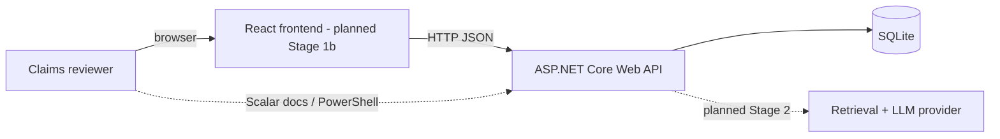
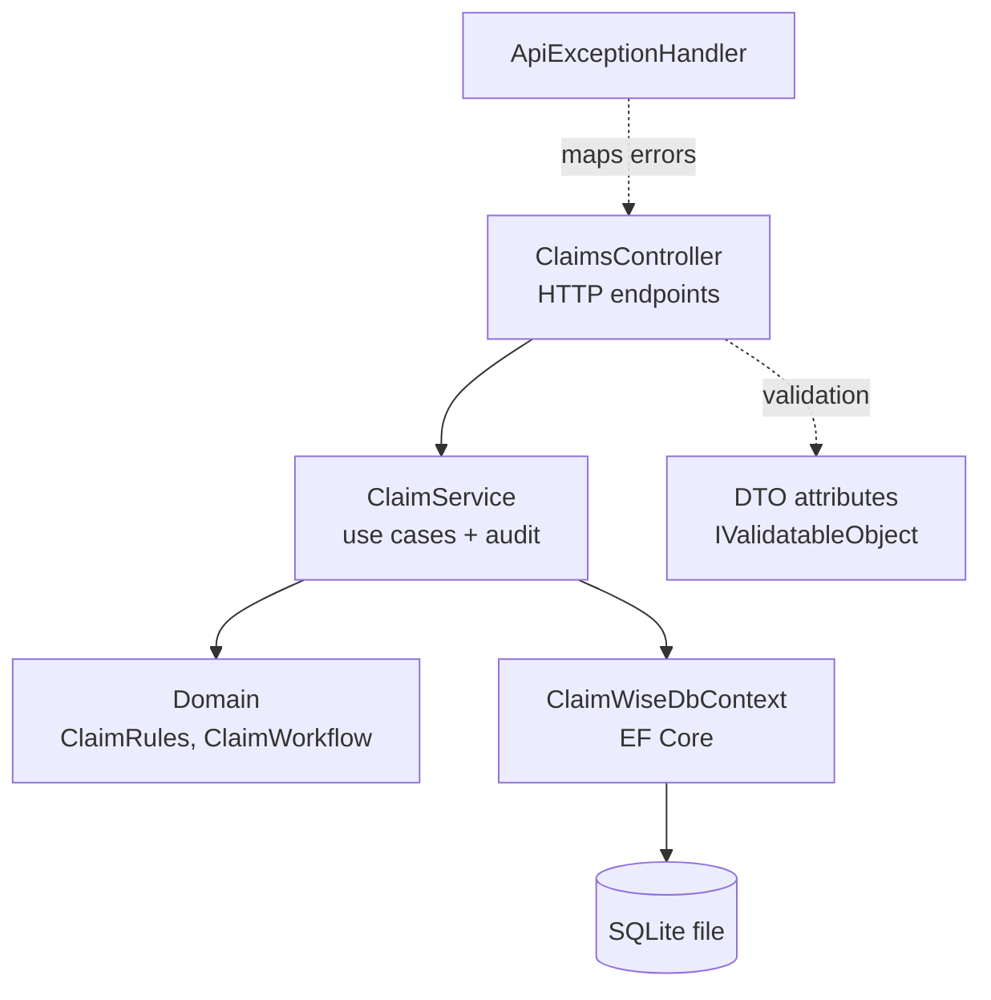
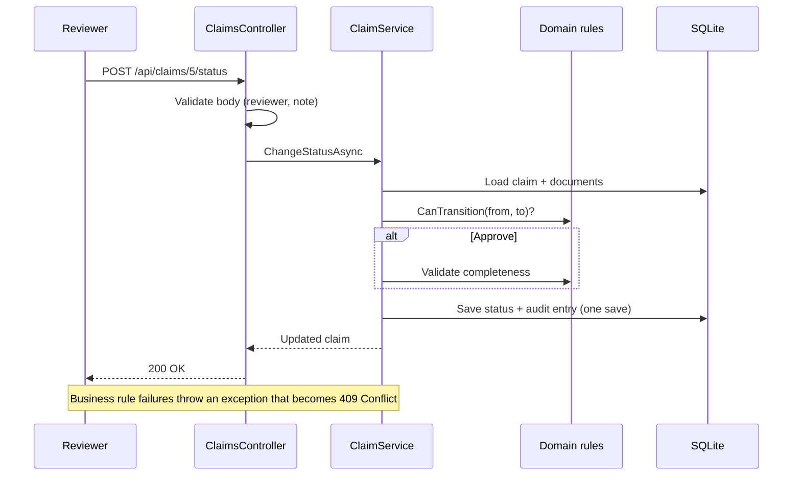
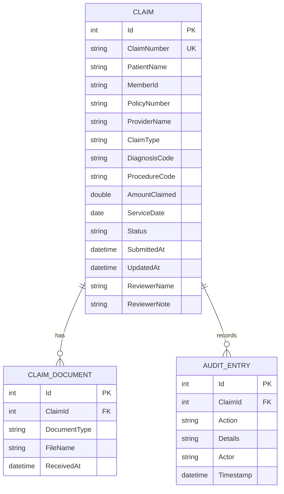
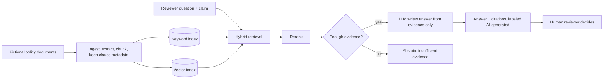

# ClaimWise AI: Architecture

Diagrams are Mermaid; GitHub and the VS Code Markdown preview (with a Mermaid extension) render them. Items marked **planned** do not exist yet.

## 1. System context

## 2. Components inside the API (implemented)

Responsibilities:

- **Controller:** receives HTTP, returns status codes. No business logic.
- **Service:** orchestrates a use case (load claim, apply rule, write audit, save).
- **Domain:** pure C# rules with no framework dependency, which is why they are easy to unit test.
- **DbContext:** the database mapping. EF Core's `DbContext` already acts as a unit of work, so there is no extra repository layer (see decisions).

## 3. Request flow: changing a claim's status

## 4. Database ER diagram

## 5. API endpoints

| Method | Path | Purpose | Success | Common errors |
|---|---|---|---|---|
| POST | `/api/claims` | Create a claim | 201 | 400 validation |
| GET | `/api/claims` | List (query: `status`, `claimType`, `search`, `sortBy`, `sortDir`, `page`, `pageSize`) | 200 | 400 bad query |
| GET | `/api/claims/summary` | Dashboard numbers | 200 | |
| GET | `/api/claims/{id}` | Detail + validation + allowed next statuses | 200 | 404 |
| GET | `/api/claims/{id}/validation` | Missing documents / fields | 200 | 404 |
| POST | `/api/claims/{id}/documents` | Record a received document | 201 | 400, 404, 409 duplicate or final claim |
| POST | `/api/claims/{id}/status` | Change status (reviewer + note) | 200 | 400, 404, 409 invalid move / incomplete |
| GET | `/api/claims/{id}/audit` | Audit history | 200 | 404 |
| GET | `/health` | Liveness check | 200 | |

Interactive documentation: `/scalar/v1` while running in Development.

## 6. Error handling

| Situation | Response |
|---|---|
| Bad input | 400, standard validation problem JSON with field names |
| Unknown claim | 404 problem JSON |
| Business rule violated | 409 problem JSON with a readable explanation |
| Anything unexpected | 500 generic problem JSON; details go to logs only |

## 7. Security considerations

Stage 1: server-side validation, whitelisted sort fields, wildcard characters stripped from search, parameterized queries via EF Core, file names validated, CORS restricted to configured origins, secrets and databases excluded from Git.
**Not yet:** authentication, authorization, rate limiting, HTTPS enforcement (all planned before deployment).

## 8. Planned Stage 2 AI architecture (not implemented)

The technology for embeddings, vector search and the LLM is deliberately **not chosen yet**; see `decisions.md`.

## 9. Deployment (planned Stage 3)

Frontend on static hosting, API on a container host, PostgreSQL for persistence (SQLite files are lost on ephemeral hosts). Free-tier limits will be verified at that time, not assumed now.
