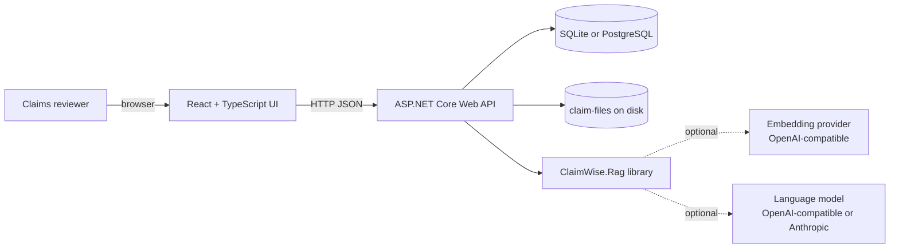
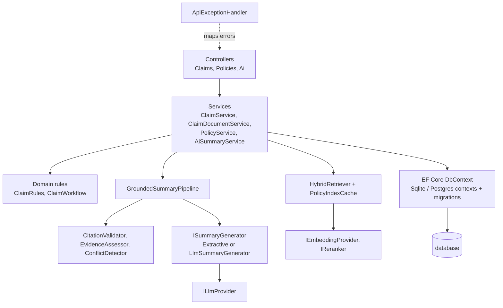
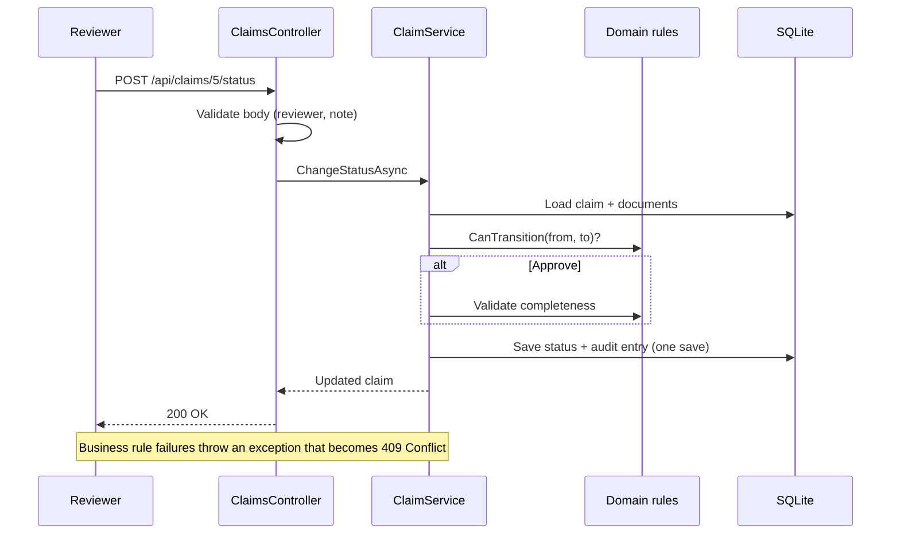
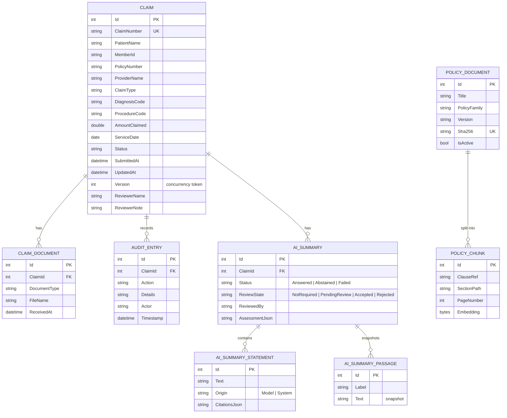

# ClaimWise AI: Architecture

Diagrams are Mermaid; GitHub and the VS Code Markdown preview (with a Mermaid extension) render them. For retrieval and grounding details see [rag.md](rag.md); for endpoints see [api.md](api.md).

## 1. System context

## 2. Components

* **Controllers**: HTTP only. **Services**: use cases, transactions, audit entries. **Domain**: pure rules, no framework.
* **ClaimWise.Rag**: no EF Core or ASP.NET dependency; every provider sits behind an interface so it can be replaced or faked.
* The DbContext is provider-neutral; `SqliteClaimWiseDbContext` / `PostgresClaimWiseDbContext` exist so each provider owns its
  migrations (see decisions D4).

## 3. Request flow: changing a claim's status

## 4. Database ER diagram

## 5. API endpoints

See [api.md](api.md) for the complete list. Interactive documentation: `/scalar/v1` in Development.

## 6. Error handling

| Situation | Response |
|---|---|
| Bad input | 400, standard validation problem JSON with field names |
| Unknown claim | 404 problem JSON |
| Business rule violated | 409 problem JSON with a readable explanation |
| Anything unexpected | 500 generic problem JSON; details go to logs only |

## 7. Security considerations

Implemented: server-side validation, whitelisted sort fields, parameterized queries, upload allow-list + content checks +
server-generated storage names, XML hardening, security headers, rate limiting on upload/AI endpoints, CORS restricted to
configured origins, secrets/databases/uploads excluded from Git, sanitised provider errors, prompts and keys never logged.
**Not implemented:** authentication, authorization, HTTPS enforcement, audit-log tamper protection (all required before any
real deployment).

## 8. AI architecture

Implemented; see [rag.md](rag.md) for the pipeline diagram, scoring, validation rules and limitations.

## 9. Deployment (not done)

Frontend on static hosting, API on a container host, PostgreSQL for persistence (SQLite files and `claim-files/` are lost on
ephemeral hosts). Not set up or verified here.
